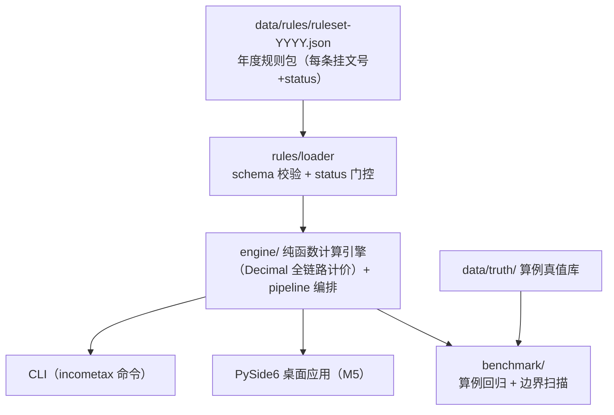

# 个人所得税联动计算器

> ✅ **v0.5.0（M5 桌面交付完成）**：CLI + PySide6 桌面应用 + Windows exe（PyInstaller onedir）三形态齐备；规则包加载 + status 门控 + 计算引擎（累计预扣/社保联动/年度汇算/年终奖单独计税）+ 年终奖双方案择优与临界区间推导 + 七项专项附加扣除管理 + 内置评测基准（1184 项全达标）全部可用。下一站 M6 发布（见 [plan/](plan/00-README总览.md)）。

累计预扣法逐月计算 · 年终奖计税方式择优（含"多发一元、到手变少"临界区间警示）· 七项专项附加扣除管理 · 社保公积金联动 · 年度汇算——核心特色是 **2019-2026 年度版本化规则集**：切换年度即切换规则，每个结果数值旁挂政策文号与条款依据，全本地计算、零上传。

> 🖥️ 桌面应用与设计说明见 [docs/技术报告.md](docs/技术报告.md)；演示截图与 GIF 见 [docs/demo/](docs/demo/)。

## ⚠️ 免责声明（强制展示）

- 本工具计算结果**仅供个人参考**，实际应纳税额以税务机关核定为准；
- 政策条文以发文机关**正式公布文本**为准；规则包中未挂原文核对（status=待核对）的条目不参与计算结论；
- 本工具不提供避税建议，临界区间提示仅为税率表机制的客观事实呈现。

## 功能规划

| 功能 | 说明 | 状态 |
|---|---|---|
| 累计预扣法逐月引擎 | 按国家税务总局公告 2018 年第 61 号公式逐字实现，逐月明细，每行挂条款依据 | ✅ M2 |
| 年终奖择优 | 双方案（单独计税 vs 并入综合）比全年总税负自动推荐；"多发一元、到手变少"临界区间由税率表机制性推导（代码零字面量） | ✅ M3 |
| 七项专项附加扣除 | 分档标准计算（孩数/城市档）、房贷与租金互斥、赡养老人分摊上限校验、大病医疗仅汇算扣除 | ✅ M3 |
| 社保公积金联动 | 基数上下限+费率（用户输入）→ 自动夹取并进入税前扣除链 | ✅ M2 |
| 年度汇算 | 应纳税额 vs 已预缴 → 应退/应补，真值算例 4 条回归 100% | ✅ M2 |
| 年度版本化规则集 | 2019-2026 共 8 份规则包，逐条挂文号，全部已核对可生效 | ✅ M1 |
| 内置评测基准 | 算例回归 + 税率级次临界 + 陷阱区间 + 扣除互斥组合四类，一条命令跑全（指标见下文「内置评测基准」） | ✅ M4 |
| 桌面应用 | PySide6 界面（年度切换/逐月表/择优对比+临界标红/扣除管理/依据面板/免责首屏）+ PyInstaller onedir exe | ✅ M5 |

## 架构



两个前端（CLI 与 GUI）消费同一引擎与同一套 `engine/pipeline.compute_full_calc` 编排，基准的 `run_all()` 也为两者共用——不另起第二套计算行为。

## 快速开始（开发态）

要求 Python ≥ 3.8（Windows 建议 `py` 启动器）。

```bash
# 建议先升级构建工具链（老 venv 的 pip 20.x 无法可编辑安装 pyproject-only 项目）
python -m pip install -U pip setuptools wheel

# 安装（开发态，含测试与 GUI 依赖；仅 CLI 用 [dev] 亦可）
python -m pip install -e ".[dev,gui]"

# 桌面应用（PySide6 图形界面）
python -m incometax.gui

# 查看 2026 年度规则包与核对状态（2019-2026 全部已核对，门控放行）
incometax rules --year 2026

# 计算：累计预扣逐月表 + 社保联动 + 年度汇算 + 年终奖单独计税
incometax calc --year 2019 --input calc-input.json   # 输入格式见下节

# 一条命令跑全内置基准（算例回归 + 税率临界 + 陷阱区间 + 互斥组合）
incometax benchmark

# 运行测试（GUI 测试常驻 offscreen，无需显示服务器）
python -m pytest
```

数据目录定位顺序：`--data-dir` 参数 > `INCOMETAX_DATA_DIR` 环境变量 > PyInstaller 内嵌（`sys._MEIPASS/data`）> 当前目录上溯查找 `data/rules`。

## 桌面应用（PySide6，M5）

图形界面与 CLI 消费同一引擎与编排，功能一一对应：

- **免责声明首屏**：确认后进入计算界面（算法口径、社保参数归属、门控语义与"非避税建议"提示先讲清楚）；
- **年度切换**：下拉切换 2019-2026 年度即切换整套规则（加载失败/门控拦截以对话框明示原因）；
- **计算输入**：逐月输入表（空 = 0）+ 社保联动参数 + 年终奖金额 + 专项附加申报管理（添加/编辑/删除七项申报）；
- **计算结果**：社保联动明细 + 申报清单 + 累计预扣逐月表 + 年度汇算 + 年终奖单独计税 + 双方案择优；奖金落入"多发一元、到手变少"临界区间时**红色横幅标注**；
- **依据面板**：来源图例（文号 + URL + 核对状态）+ 本次结果引用的全部依据（短引用 → 文号条款全文），复用 `report.render_ref`，与 CLI 同一渲染语义；
- **内置基准**：复用 `benchmark.runner.run_all()` 同一 API，指标表 + 失败明细。

```bash
python -m incometax.gui                    # 开发态启动
python -m incometax.gui --data-dir <路径>   # 指定数据目录
```

### 打包 Windows exe（PyInstaller onedir）

```bash
python -m pip install -e ".[pkg]"          # PyInstaller（3.8 上 pin 5.x，见 pyproject）
py -X utf8 tools/build_package.py --clean-build   # 打包 + 构建后断言
py -X utf8 tools/verify_package.py               # 中立目录冻结态验收
```

- 产物 `dist/个人所得税联动计算器/`（onedir），规则包与真值库内嵌 `sys._MEIPASS/data`；
- **构建后断言**（不过即判失败）：dist 无禁区成分（无源码/缓存/测试/计划文档）、内嵌 `data/rules` 与 `data/truth` 和仓库**逐文件 sha256 对账**一致、携带 PySide6 且未混入被排除的重依赖；
- **冻结态验收**：在**临时中立目录**调用 `exe --selftest <输入> <输出>`，验证内嵌数据定位（断言落在 dist 内、非仓库）、calc 全链路、内置基准全达标、GUI offscreen 冒烟。

## calc 输入格式（CLI `--input` JSON）

```jsonc
{
  // 月度输入（二选一）：① months 显式列表（1-12 个月，缺月按 0 补足并标注）
  "months": [
    {"gross": "10000.00", "tax_free": "0.00", "special_deduction": "2000.00",
     "special_additional_deduction": "0.00", "other_deduction": "0.00"}
  ],
  // ② uniform_month + month_count（等额月 × N）
  "uniform_month": {"gross": "10000.00", "special_deduction": "2000.00"},
  "month_count": 3,

  // 可选：社保公积金联动（基数/费率全部用户输入；自动夹取基数到 [下限, 上限]，
  // 个人部分合计逐月计入专项扣除）
  "social": {
    "base_input": "10000.00", "base_lower": "4000.00", "base_upper": "25000.00",
    "rates": {"养老": "0.08", "医疗": "0.02", "失业": "0.005", "公积金": "0.12"}
  },

  // 可选：全年一次性奖金（提供后同时输出单独计税、双方案择优对比与临界区间提示；
  // 择优的方案 B 以"不含奖金的汇算口径"重算，故 settlement 覆盖字段勿含奖金）
  "bonus_income": "36001.00",

  // 可选：七项专项附加扣除申报清单（违规整单拒绝并挂条款，退出码 2）
  // item ∈ child_education / infant_care / continue_education / serious_illness /
  //        housing_loan / housing_rent / support_elderly（键与规则包一致）
  "special_additional_claims": [
    // 子女教育/婴幼儿照护：孩数 + 分摊比例（1=一方全额 或 0.5=双方各半）
    {"item": "child_education", "children": 1, "share_ratio": "1.0"},
    // 继续教育：kind=academic（按月，可指定 months）/ vocational（取得证书当年定额，计入汇算）
    {"item": "continue_education", "kind": "academic", "months": 12},
    // 大病医疗：医保目录内自付累计 → 起付线以上、限额以内据实扣除（仅年度汇算）
    {"item": "serious_illness", "self_paid_total": "30000.00"},
    // 房贷利息（定额，一方全额）/ 住房租金（tier 0/1/2 = 直辖市省会等/人口超100万/不超100万）
    // ⚠️ 两者互斥，同时申报整单拒绝
    {"item": "housing_rent", "tier": 1, "months": 12},
    // 赡养老人：独生子女定额；非独生填 monthly_amount（≤每人上限），
    // 可附 other_shared_amounts 校验全体赡养人合计 ≤ 扣除额度
    {"item": "support_elderly", "only_child": true}
  ],

  // 可选：年度汇算覆盖字段（缺省 = 由月度输入聚合：Σ收入/Σ专项/Σ附加/Σ其他 + 引擎已预扣合计；
  // 有申报清单时，仅汇算项如大病医疗由引擎自动并入汇算链）
  "settlement": {
    "annual_gross": "200000.00",
    "annual_special_deduction": "40000.00",
    "annual_special_additional_deduction": "60000.00",
    "annual_other_deduction": "0.00",
    "withheld_total": "0.00"
  }
}
```

- 金额字段一律 Decimal 语义字符串（两位小数）；未知字段、非法数值按用法错误（退出码 2）拒绝；
- 退出码：`0` 成功 / `1` 运行期失败（门控拦截、计算失败）/ `2` 用法与输入错误（含扣除申报违规，如房贷与租金互斥）；
- 输出：专项附加申报清单（逐项挂依据，违规整单拒绝）+ 逐月预扣表（每行挂 减除费用+税率级次 条款依据）+ 社保联动明细 + 年度汇算（应退/应补）+ 年终奖单独计税 + 择优对比（两方案全年总税负/差额/推荐）+ 临界区间提示（落入区间标 `[!!]`）+ 依据来源图例 + 免责声明。

## 内置评测基准（M4）

纯规则通路（数据只来自 `data/rules` 与 `data/truth`）、零 API、无随机数、固定输入可复现；期望值由独立实现路径（推导公式）与引擎**双向对账**，避免"同一代码自己测自己"。**每里程碑收尾必跑**（防回退纪律，见 plan/05 §三）：

```bash
incometax benchmark        # --year 可指定陷阱区间穷举深扫的代表年度（缺省 = 最新可用年度）
```

| 基准 | 方法 | 达标线 | 当前结果（v0.5.0） |
|---|---|---|---|
| 算例回归 | `data/truth` 真值算例 × 引擎输出全字段键集对账 | 通过率 100% | 4/4 ✅ |
| 税率级次临界 | 两张税率表 96 个有限边界 ±0.01 精确邻域：级次切换、年度表税额连续 / 年终奖查表跳变、汇算与单独计税引擎通路（含商数定档死区） | 与规则表自洽 100% | 752/752 ✅ |
| 年终奖陷阱区间 | 6 个推导区间：查表死区逐分扫描 + 端点内外 ±0.01 + 粗细两段穷举（粗扫全区间 1 元步长、恢复窗口逐分细扫） | 穷举恢复点 = 推导右端点申报精度值，一致 100% | 6/6 ✅ |
| 扣除互斥组合 | 全年度规则包 × 组合矩阵（房贷×租金全档位、赡养分摊上限边界、重复申报、非法字段、年度适用 + 有效对照） | 误放行 0 且误拒 0 | 190 违规组合全拒绝、122 有效组合全放行 ✅ |

合计 1184 项检查全过，单次运行不足 1 秒。CLI 退出码：`0` 全部达标 / `1` 未达标或门控拦截 / `2` 用法错误；GUI「内置基准」页复用同一 `run_all()` API。

## 目录结构

```
├── plan/                  # 计划文档（题目定义/需求/架构/详设/里程碑/决策）
├── data/
│   ├── rules/             # 年度规则包 JSON（2019-2026，逐条挂文号+status）
│   └── truth/             # 算例真值库（逐条登记来源）
├── docs/
│   ├── 技术报告.md         # 版本化规则集 / 临界区间推导 / 依据联动 三主题
│   └── demo/              # 演示截图与 GIF
├── src/incometax/
│   ├── rules/             # 规则包加载 + schema 校验 + status 门控
│   ├── engine/            # 计算引擎（累计预扣/年终奖/扣除/社保/汇算）+ pipeline 编排
│   ├── benchmark/         # 内置评测基准
│   └── gui/               # PySide6 桌面应用（M5）
├── tests/
└── tools/                 # 生成器/打包/验收/演示素材脚本
```

## 限制

- 首期仅覆盖工资薪金 + 全年一次性奖金 + 年度汇算简化口径；经营所得、股权激励、财产租赁转让等复杂所得类型不在范围内；
- 不对接税务局接口、不做申报代办；
- 社保公积金缴费基数上下限与费率因城市而异，全部由用户输入，规则包不存全国值；
- 政策快照以规则包核对日期为准，年度间政策变化（如 2023 年专项附加扣除三项提标）通过切换年度规则包体现。

## 免责声明

本项目为个人学习与效率工具，与任何政府机关、税务机关无关；不构成税务、法律或财务建议。详见上文"免责声明"。

## 许可

[MIT](LICENSE)
