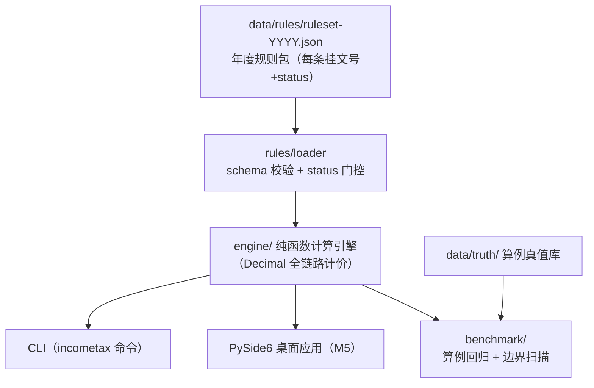

# 个人所得税联动计算器

> 🚧 **开发中（骨架阶段，v0.1.0）**：计划与架构已定稿（见 [plan/](plan/00-README总览.md)），规则加载与 status 门控可用，计算引擎在 M2 起逐步实装。

累计预扣法逐月计算 · 年终奖计税方式择优（含"多发一元、到手变少"临界区间警示）· 七项专项附加扣除管理 · 社保公积金联动 · 年度汇算——核心特色是 **2019-2026 年度版本化规则集**：切换年度即切换规则，每个结果数值旁挂政策文号与条款依据，全本地计算、零上传。

## ⚠️ 免责声明（强制展示）

- 本工具计算结果**仅供个人参考**，实际应纳税额以税务机关核定为准；
- 政策条文以发文机关**正式公布文本**为准；规则包中未挂原文核对（status=待核对）的条目不参与计算结论；
- 本工具不提供避税建议，临界区间提示仅为税率表机制的客观事实呈现。

## 功能规划

| 功能 | 说明 | 状态 |
|---|---|---|
| 累计预扣法逐月引擎 | 按国家税务总局公告 2018 年第 61 号公式逐字实现，逐月明细 | 规划中（M2） |
| 年终奖择优 | 单独计税 vs 并入综合所得双方案对比；临界区间由税率表机制性推导（不硬编码） | 规划中（M3） |
| 七项专项附加扣除 | 分档/互斥/分摊规则化管理，大病医疗仅汇算扣除 | 规划中（M3） |
| 社保公积金联动 | 基数上下限+费率 → 自动进入税前扣除链 | 规划中（M2） |
| 年度汇算 | 应纳税额 vs 已预缴 → 应退/应补 | 规划中（M2） |
| 年度版本化规则集 | 2019-2026 规则包 JSON，逐条挂文号+核对状态，未核对不得生效 | ✅ 骨架可用 |
| 内置评测基准 | 官方算例真值 + 边界扫描，零 API 依赖可复现 | 规划中（M4） |
| 桌面应用 | PySide6 + Windows exe（GitHub Release 附安装包） | 规划中（M5） |

## 架构



## 快速开始（开发态）

要求 Python ≥ 3.8（Windows 建议 `py` 启动器）。

```bash
# 建议先升级构建工具链（老 venv 的 pip 20.x 无法可编辑安装 pyproject-only 项目）
python -m pip install -U pip setuptools wheel

# 安装（开发态，含测试依赖）
python -m pip install -e ".[dev]"

# 查看 2026 年度规则包与核对状态（当前含待核对条目属预期，M1 逐条核对后清零）
incometax rules --year 2026

# 运行测试
python -m pytest
```

数据目录定位顺序：`--data-dir` 参数 > `INCOMETAX_DATA_DIR` 环境变量 > PyInstaller 内嵌（`sys._MEIPASS/data`）> 当前目录上溯查找 `data/rules`。

## 目录结构

```
├── plan/                  # 计划文档（题目定义/需求/架构/详设/里程碑/决策）
├── data/
│   ├── rules/             # 年度规则包 JSON（2019-2026，逐条挂文号+status）
│   └── truth/             # 算例真值库（逐条登记来源）
├── src/incometax/
│   ├── rules/             # 规则包加载 + schema 校验 + status 门控
│   ├── engine/            # 计算引擎（累计预扣/年终奖/扣除/社保/汇算）
│   └── benchmark/         # 内置评测基准
├── tests/
└── tools/                 # 生成器/审计脚本
```

## 限制

- 首期仅覆盖工资薪金 + 全年一次性奖金 + 年度汇算简化口径；经营所得、股权激励、财产租赁转让等复杂所得类型不在范围内；
- 不对接税务局接口、不做申报代办；
- 社保公积金缴费基数上下限与费率因城市而异，全部由用户输入，规则包不存全国值；
- 政策快照以规则包核对日期为准，年度间政策变化（如 2023 年专项附加扣除三项提标）通过切换年度规则包体现。

## 免责声明

本项目为个人学习与效率工具，与任何政府机关、税务机关无关；不构成税务、法律或财务建议。详见上文"免责声明"。

## 许可

[MIT](LICENSE)
