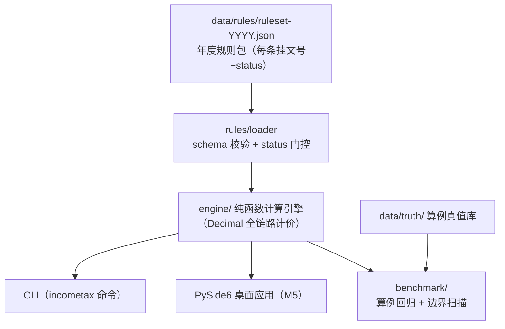

# 个人所得税联动计算器

> 🚧 **开发中（v0.2.0，M2 计算引擎完成）**：规则包加载 + status 门控 + 计算引擎（累计预扣/社保联动/年度汇算/年终奖单独计税）已可用，CLI `calc` 可算真值算例；下一站 M3 择优与扣除（见 [plan/](plan/00-README总览.md)）。

累计预扣法逐月计算 · 年终奖计税方式择优（含"多发一元、到手变少"临界区间警示）· 七项专项附加扣除管理 · 社保公积金联动 · 年度汇算——核心特色是 **2019-2026 年度版本化规则集**：切换年度即切换规则，每个结果数值旁挂政策文号与条款依据，全本地计算、零上传。

## ⚠️ 免责声明（强制展示）

- 本工具计算结果**仅供个人参考**，实际应纳税额以税务机关核定为准；
- 政策条文以发文机关**正式公布文本**为准；规则包中未挂原文核对（status=待核对）的条目不参与计算结论；
- 本工具不提供避税建议，临界区间提示仅为税率表机制的客观事实呈现。

## 功能规划

| 功能 | 说明 | 状态 |
|---|---|---|
| 累计预扣法逐月引擎 | 按国家税务总局公告 2018 年第 61 号公式逐字实现，逐月明细，每行挂条款依据 | ✅ M2 |
| 年终奖择优 | 单独计税原语已可用（✅ M2）；双方案对比与临界区间推导（M3） | 🚧 M3 |
| 七项专项附加扣除 | 分档/互斥/分摊规则化管理，大病医疗仅汇算扣除 | 规划中（M3） |
| 社保公积金联动 | 基数上下限+费率（用户输入）→ 自动夹取并进入税前扣除链 | ✅ M2 |
| 年度汇算 | 应纳税额 vs 已预缴 → 应退/应补，真值算例 4 条回归 100% | ✅ M2 |
| 年度版本化规则集 | 2019-2026 共 8 份规则包，逐条挂文号，全部已核对可生效 | ✅ M1 |
| 内置评测基准 | 官方算例真值 + 边界扫描，零 API 依赖可复现 | 规划中（M4） |
| 桌面应用 | PySide6 + Windows exe（GitHub Release 附安装包） | 规划中（M5） |

## 架构



## 快速开始（开发态）

要求 Python ≥ 3.8（Windows 建议 `py` 启动器）。

```bash
# 建议先升级构建工具链（老 venv 的 pip 20.x 无法可编辑安装 pyproject-only 项目）
python -m pip install -U pip setuptools wheel

# 安装（开发态，含测试依赖）
python -m pip install -e ".[dev]"

# 查看 2026 年度规则包与核对状态（2019-2026 全部已核对，门控放行）
incometax rules --year 2026

# 计算：累计预扣逐月表 + 社保联动 + 年度汇算 + 年终奖单独计税
incometax calc --year 2019 --input calc-input.json   # 输入格式见下节

# 运行测试
python -m pytest
```

数据目录定位顺序：`--data-dir` 参数 > `INCOMETAX_DATA_DIR` 环境变量 > PyInstaller 内嵌（`sys._MEIPASS/data`）> 当前目录上溯查找 `data/rules`。

## calc 输入格式（CLI `--input` JSON）

```jsonc
{
  // 月度输入（二选一）：① months 显式列表（1-12 个月，缺月按 0 补足并标注）
  "months": [
    {"gross": "10000.00", "tax_free": "0.00", "special_deduction": "2000.00",
     "special_additional_deduction": "0.00", "other_deduction": "0.00"}
  ],
  // ② uniform_month + month_count（等额月 × N）
  "uniform_month": {"gross": "10000.00", "special_deduction": "2000.00"},
  "month_count": 3,

  // 可选：社保公积金联动（基数/费率全部用户输入；自动夹取基数到 [下限, 上限]，
  // 个人部分合计逐月计入专项扣除）
  "social": {
    "base_input": "10000.00", "base_lower": "4000.00", "base_upper": "25000.00",
    "rates": {"养老": "0.08", "医疗": "0.02", "失业": "0.005", "公积金": "0.12"}
  },

  // 可选：全年一次性奖金（单独计税口径，164号第一条（一）；择优对比 M3 提供）
  "bonus_income": "36000.00",

  // 可选：年度汇算覆盖字段（缺省 = 由月度输入聚合：Σ收入/Σ专项/Σ附加/Σ其他 + 引擎已预扣合计）
  "settlement": {
    "annual_gross": "200000.00",
    "annual_special_deduction": "40000.00",
    "annual_special_additional_deduction": "60000.00",
    "annual_other_deduction": "0.00",
    "withheld_total": "0.00"
  }
}
```

- 金额字段一律 Decimal 语义字符串（两位小数）；未知字段、非法数值按用法错误（退出码 2）拒绝；
- 退出码：`0` 成功 / `1` 运行期失败（门控拦截、计算失败）/ `2` 用法与输入错误；
- 输出：逐月预扣表（每行挂 减除费用+税率级次 条款依据）+ 社保联动明细 + 年度汇算（应退/应补）+ 年终奖单独计税块 + 依据来源图例 + 免责声明。

## 目录结构

```
├── plan/                  # 计划文档（题目定义/需求/架构/详设/里程碑/决策）
├── data/
│   ├── rules/             # 年度规则包 JSON（2019-2026，逐条挂文号+status）
│   └── truth/             # 算例真值库（逐条登记来源）
├── src/incometax/
│   ├── rules/             # 规则包加载 + schema 校验 + status 门控
│   ├── engine/            # 计算引擎（累计预扣/年终奖/扣除/社保/汇算）
│   └── benchmark/         # 内置评测基准
├── tests/
└── tools/                 # 生成器/审计脚本
```

## 限制

- 首期仅覆盖工资薪金 + 全年一次性奖金 + 年度汇算简化口径；经营所得、股权激励、财产租赁转让等复杂所得类型不在范围内；
- 不对接税务局接口、不做申报代办；
- 社保公积金缴费基数上下限与费率因城市而异，全部由用户输入，规则包不存全国值；
- 政策快照以规则包核对日期为准，年度间政策变化（如 2023 年专项附加扣除三项提标）通过切换年度规则包体现。

## 免责声明

本项目为个人学习与效率工具，与任何政府机关、税务机关无关；不构成税务、法律或财务建议。详见上文"免责声明"。

## 许可

[MIT](LICENSE)
