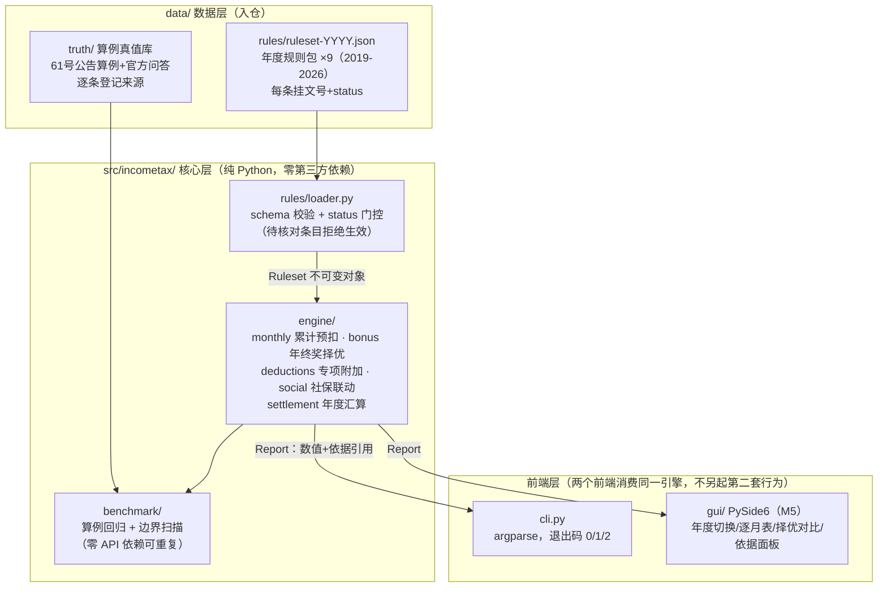

# 03 架构与技术选型

> 定稿日期：2026-10-07。本文固化分层架构、数据流与技术选型；模块内部设计见 [04-模块详设.md](04-模块详设.md)。

## 一、架构总图



核心原则：

1. **规则包是唯一事实源**：税率表、扣除标准、政策有效期全部来自 `ruleset-YYYY.json`；引擎代码中**不出现任何政策数值字面量**（临界区间边界同样由规则表推导）。
2. **status 门控前置**：加载器校验 schema 与 status，`status=待核对` 的条目不可参与结论计算（引擎入口统一拦截），这是"无出处数值不得生效"红线的代码化。
3. **引擎纯函数化**：输入（Ruleset + 用户参数）→ 输出（Report），无 IO 无全局状态；CLI 与 GUI 是两个薄壳。
4. **每个结果数值挂依据**：Report 中每个数值条目携带 `ref`（指向规则包条目的 文号+条款），GUI 依据面板直接渲染。

## 二、技术选型

| 维度 | 选型 | 理由 |
|---|---|---|
| 语言 | Python，`requires-python >= 3.8` | 本机 3.8.8 + 3.12 双版本；3.8 兼容写法约束（无 match/PEP604 运行期联合类型）M0 起执行 |
| 运行期依赖 | **零第三方依赖**（纯 stdlib：json/dataclasses/decimal/argparse） | 税额计算是纯确定性数值问题；零依赖 = 打包最小、CI 稳、审计简单 |
| 计价类型 | **`decimal.Decimal` 全链路** | 边界扫描要检出"多发一元"级别差异，float 尾差会污染临界点判定；规则包 JSON 以 `parse_float=Decimal` 加载 |
| 测试 | pytest（dev extra） | 事实标准；测试期依赖显式进 extras |
| GUI | PySide6（gui extra，M5） | 题定交付形态；3.8 上限实测 6.6.x（6.7+ requires-python≥3.9，pip 自动回避，extras 写 `<6.7` 双保险） |
| 打包 | PyInstaller（pkg extra，M5）；3.8 上 pin `>=5.13,<6` | 6.x 在 3.8 有 modulegraph dis 崩溃实录，pin 上限 |
| CI | GitHub Actions 矩阵：windows-latest × {3.8, 3.12} + ubuntu-latest × 3.12 | 开发机主版本 3.8 必须在矩阵内；3.8 在 ubuntu 新镜像可用性存疑，ubuntu 只跑 3.12 降风险（首跑后按实况调整） |
| LLM | **不使用** | 本项目全部结论由确定性规则产生，无解析兜底需求（与系列文档处理类项目不同，无 LLM 兜底阶段） |

## 三、目录结构（骨架即最终形态，后续里程碑只填充不搬迁）

```
10-7-income-tax-calculator/
├── plan/                      # 计划文档（入仓）
├── data/
│   ├── README.md              # 数据台账（来源+许可+status）
│   ├── rules/
│   │   ├── README.md          # 规则包 schema 说明与年份覆盖表
│   │   ├── ruleset-2022.json  # 骨架示例：旧扣除标准（结构演示，M1 补全核对）
│   │   └── ruleset-2026.json  # 骨架示例：现行标准（M1 挂原文逐条核对）
│   └── truth/                 # 算例真值库（M1 建）
├── src/incometax/
│   ├── __init__.py            # __version__
│   ├── __main__.py            # python -m incometax
│   ├── cli.py                 # CLI（退出码 0/1/2 锁进测试）
│   ├── rules/
│   │   ├── schema.py          # schema 常量与校验函数
│   │   └── loader.py          # 加载+门控+状态报告
│   ├── engine/
│   │   ├── monthly.py         # FR-1 累计预扣（M2）
│   │   ├── bonus.py           # FR-2 择优+临界区间（M3）
│   │   ├── deductions.py      # FR-3 七项扣除（M3）
│   │   ├── social.py          # FR-4 社保联动（M2）
│   │   └── settlement.py      # FR-5 年度汇算（M2）
│   └── benchmark/             # FR-7（M4）
├── tests/                     # pytest（骨架期 3 个模块先行）
├── tools/                     # 生成器/审计脚本（M1 起）
├── docs/                      # 技术报告（M5）
├── .github/workflows/ci.yml
├── .gitattributes             # * text=auto eol=lf（CI 首跑绿前置）
├── pyproject.toml
├── README.md
└── LICENSE                    # MIT
```

## 四、关键设计决策

| # | 决策 | 说明 |
|---|---|---|
| D-1 | Decimal 计价 | 见选型表；规则包数值一律整数或精确小数，杜绝 float |
| D-2 | 规则包 status 门控 | `已核对`/`待核对` 两态；加载器可整体加载用于**结构预览**，但 `effective_ruleset()` 才能进引擎——存在待核对条目时抛 `RulesetNotEffective` 并列出条目清单（骨架期即实现并测试） |
| D-3 | CLI 退出码：`0`=成功，`1`=运行期失败（含功能未实现），`2`=用法/输入错误 | 定稿后锁进 CLI 测试，后续重构不漂移 |
| D-4 | 社保公积金参数全部用户输入 | 基数上下限/费率城市差异大，规则包**不存**全国值；引擎只做计算与区间校验 |
| D-5 | src 布局 + 零运行期依赖 | 打包白名单最小化；`pip install -e .[dev]` 即开发态 |
| D-6 | 仓库布局 = 包根 + plan/ 整体入仓 | 干净环境"按 README 一次跑通"的前提；README 深链成立 |
| D-7 | 本仓库 git 提交邮箱 = GitHub noreply（`282769740+yuluo554@users.noreply.github.com`） | 从骨架提交起阻断个人 QQ 邮箱进历史；首提交（1481cc8）已含 QQ 邮箱，M6 env-filter 统一改写 |
| D-8 | GitHub 仓库名发布时确认（默认 `income-tax-calculator` 纯净名） | 本地目录保留 `10-7` 日期标签（用户指定），见 plan/00 |
